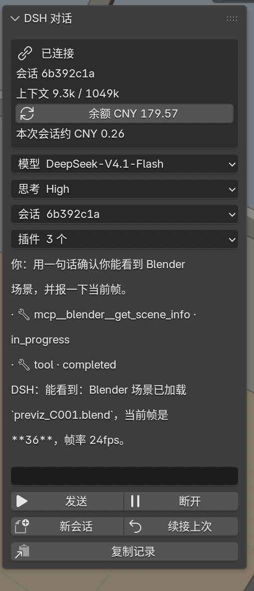

# DSH Chat for Blender

[](https://github.com/Toobe53/blender-dsh-chat/releases)
[](LICENSE)

Chat with a [DeepSeek Harness](https://github.com/deepseek-ai/deepseek-harness) agent
inside Blender. The agent runs through ACP (Agent Client Protocol) over stdio and
drives **this** Blender session through the official Blender MCP add-on — you watch
the viewport while you talk.



## Features

- Chat panel in the 3D Viewport sidebar (**Item** tab, press `N`)
- Streaming replies, tool-call log
- Model picker (DeepSeek-V4.1-Flash / V4-Pro) and reasoning effort
- Permission prompts for sandbox escalation: allow once / always this session / reject
- Session list and resume
- Portable: preferences for `dsh`, profile, python, working directory; bundled MCP
  bridge; auto-creates the ACP profile on first connect
- Uses Blender's bundled Python (no system `python3` needed)
- Dependency self-check (dsh / node / python / MCP add-on / port / profile)

## Requirements

- Blender 5.1+
- DeepSeek Harness with `dsh` on `PATH`
- The official Blender MCP add-on enabled (ships with Blender 5.1+, listens on
  127.0.0.1:9876)
- A logged-in DeepSeek account (the `deepseek-account` provider)

## Install

Download `blender_dsh_chat-1.0.0.zip` from the release page, then
Preferences → Add-ons → **Install…** → select the zip → enable **DSH Chat**.

Manual fallback: copy the `blender_dsh_chat/` folder into Blender's
`scripts/addons/` directory.

The first connection creates `~/.dsh/profiles/blender/package.json`
(`dsh-base` + `dsh-acp-app`) if missing.

## Usage

1. Press `N` in the 3D Viewport → **Item** tab → **DSH 对话**
2. Type a message, click **发送**
3. Watch the viewport; tool calls show up in the panel

## Architecture

```
Blender panel ── ACP (stdio JSON-RPC) ── dsh --profile blender ── agent
                                                          │ MCP
                                                          ▼
                              official MCP add-on (:9876) ── current scene
```

## Known limitations

- Single-line input (Blender limitation)
- Permission prompts appear on sandbox escalation, not for every tool
- Chat history is not persisted across restarts

## License

MIT
