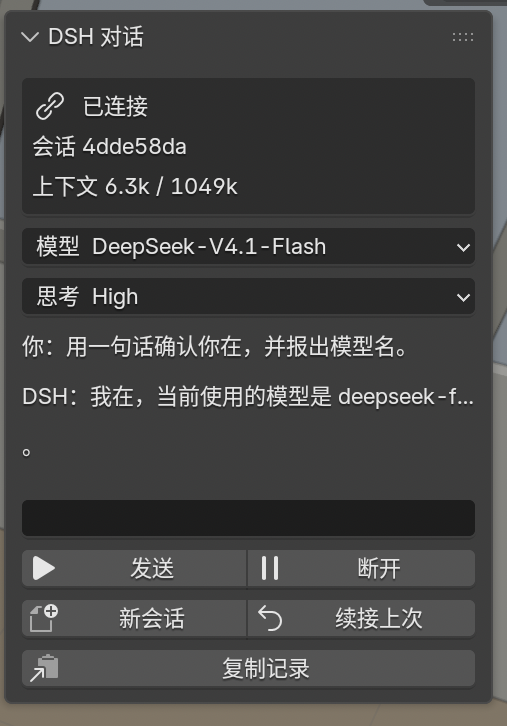

# DSH Chat · 在 Blender 里和 DSH 对话



3D 视图侧栏（**Item / 条目**页）里的聊天面板。DSH 的每个操作都跑在**你现在开着的这个 Blender 会话**里——
它改场景、设帧、选相机，你都在视口里实时看到。

---

## 为什么之前显示“缺失插件”

插件最早是**软链接**进 `scripts/addons/` 的，而且是在 Blender 已经启动之后才建的。
Blender 的插件列表是启动时缓存的，所以偏好设置里一直显示“缺失插件”，直到重启。

现在已改成**实体目录**安装，并刷新过列表：

```
~/Library/Application Support/Blender/5.2/scripts/addons/blender_dsh_chat/
```

偏好设置 → 插件 里现在显示为 **DSH Chat**（已勾选）。保险起见重启一次 Blender，
列表就彻底干净了。

## 这一版新增（v0.4）

| 功能 | 说明 |
|---|---|
| **模型选择** | 面板里「模型」下拉：DeepSeek-V4.1-Flash / DeepSeek-V4-Pro，切换即时生效（`session/set_config_option`） |
| **思考深度** | 「思考」下拉：Off / Low / High / Max |
| **续接上次** | 恢复本工作目录最近一次 ACP 会话（`session/list` + `session/resume`），agent 记得上下文 |
| 面板位置 | 从隐藏的 DSH 标签移到 **Item（条目）** 页顶部，按 N 就能看到 |
| **权限确认** | DSH 请求沙箱升级时，面板弹出「允许一次 / 拒绝 / 本会话总是允许」，agent 会停在那里等你点 |
| **会话列表** | 「会话」菜单列出最近 15 个会话，点一下就能续接（自动带原 cwd） |
| **可移植** | 新增插件偏好设置（dsh 路径、profile、python、工作目录）；MCP bridge 随插件打包，不再依赖项目路径；首次连接自动创建 ACP profile |

## 原理

```
┌──────────────────────────── Blender ────────────────────────────┐
│  DSH Chat 面板                                                   │
│     │ stdio JSON-RPC (ACP v1)                                    │
│     ▼                                                            │
│  dsh --profile blender  ──►  DSH agent（模型/思考/会话都可切）    │
│                                   │ MCP tool call                │
│                                   ▼                              │
│  官方 MCP 插件 (端口 9876)  ◄──  blender_mcp_bridge.py           │
│     │ 执行 Python                                                │
│     ▼                                                            │
│  当前场景（你看到的视口）                                         │
└──────────────────────────────────────────────────────────────────┘
```

## 使用

1. 3D 视图按 **N**，**Item** 页往下就是「DSH 对话」。
2. 输入 → **发送**（Blender 文本框不支持回车发送）。
3. 顶部两个下拉切模型 / 思考深度；`续接上次` 恢复上下文。
4. `复制记录` 会把完整对话写进 Text 数据块 `DSH 对话记录`。

## 和网页版 DSH 的差别

面板是 **ACP 前端**，不是把网页塞进 Blender。所以：

- **有**：同一套 agent 工具（bash / 文件 / MCP / Blender）、模型选择、思考深度、会话续接、流式输出、工具调用回显。
- **没有**：插件市场、费用面板、网页搜索 UI、技能商店——这些是 DSH 宿主的界面功能，ACP 不暴露。
- **agent 能力**由 `~/.dsh/profiles/blender` 决定。要加技能/插件，往这个 profile 的
  `dsh.profile.bundles` 里加 bundle（例如 `dsh-remotion`、`dsh-context`）即可。

## 依赖

- ACP profile：`~/.dsh/profiles/blender/package.json`

  ```json
  {
    "name": "dsh-profile-blender",
    "private": true,
    "dependencies": {},
    "dsh": { "profile": { "bundles": ["@deepseek-ai/dsh-base", "@deepseek-ai/dsh-acp-app"] } }
  }
  ```

- 官方 Blender MCP 插件（Blender 5.1+ 自带）需启用，端口 9876 监听。
- `dsh` 和 `node` 在 `/usr/local/bin`（插件启动子进程时会补 PATH）。

## 权限确认的边界（重要）

DSH 的审批模型是 **沙箱 + 升级时询问**，不是“每个工具都弹窗”：

- 普通读、工作目录内的写：直接执行，不打扰。
- 越界写、需要提权的命令：agent 停下，面板弹「允许一次 / 拒绝 / 本会话总是允许」。
- 想连普通操作也拦，只能改 DSH 的沙箱/审批策略（ACP 不暴露“逐工具询问”开关）。

## 已知限制

- 单行输入；长 prompt 建议粘贴。
- 对话历史不持久化（重启清空，`复制记录` 留档）。
- 面板只画最近若干行，完整内容看 `DSH 对话记录`。

## 路线图

- [x] 模型 / 思考深度切换
- [x] 权限确认（沙箱升级）
- [x] 可移植（偏好设置 + 内置 bridge + profile 自举）
- [x] 会话列表（多会话切换）
- [ ] 插件管理（列表 / 开关 / 本地安装）
- [ ] 费用（DeepSeek 账户余额/用量）
- [ ] GitHub 开源（Toobe53/blender-dsh-chat）

## 文件

| 文件 | 作用 |
|---|---|
| `__init__.py` | 面板、模型/思考菜单、状态机、定时器 |
| `acp_client.py` | ACP v1 客户端（stdio JSON-RPC、配置切换、会话恢复、权限应答） |

## 排错

- **还是“缺失插件”**：重启 Blender；确认实体目录存在且 `__init__.py` 可读。
- **一直“启动 DSH…”**：确认 `/usr/local/bin/dsh`、`/usr/local/bin/node` 存在。
- **工具报连不上 9876**：官方 MCP 插件没启用，或端口被占。
