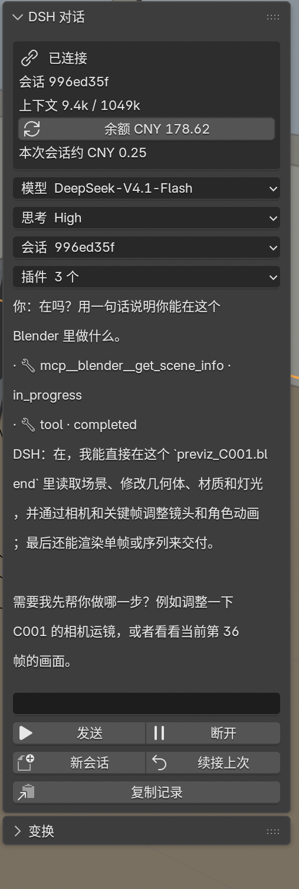

# DSH Chat for Blender · 正式介绍

> 在 Blender 的 3D 视图侧栏里和 DeepSeek Harness 对话，agent 的每一步操作都直接落在
> 你当前打开的场景里——你看得到视口变化，也看得到它调用了什么工具。

- 版本：1.0.0
- 许可：MIT
- 仓库：<https://github.com/Toobe53/blender-dsh-chat>
- 测试环境：macOS + Blender 5.2.3 LTS + DeepSeek Harness 0.2.x

---

## 1. 解决什么问题

用 Blender 做预演、layout、批量修改时，AI 助手的价值不在“给建议”，而在“直接动手”。
但网页版对话和 Blender 是两个窗口：你说一句、切过去、看结果、再切回来，节奏是断的。

DSH Chat 把对话放进 Blender 侧栏，并且让 agent 通过 **Blender 官方 MCP 插件**在**同一个
Blender 进程**里执行 Python。于是形成闭环：

1. 你在面板里说需求；
2. agent 调用 Blender 工具；
3. 视口立刻变化；
4. 你在面板里继续追问或纠正。

不需要截图、录屏或复制粘贴命令。

---

## 2. 核心能力

| 能力 | 说明 |
|---|---|
| 内嵌对话 | 3D 视图 → 侧栏 **Item（条目）** 页 → 「DSH 对话」；流式输出、工具调用逐条显示 |
| 模型选择 | DeepSeek-V4.1-Flash / DeepSeek-V4-Pro，会话内即时切换 |
| 思考深度 | Off / Low / High / Max，按任务难度调 |
| 权限确认 | 沙箱升级时弹出「允许一次 / 拒绝 / 本会话总是允许」，agent 停下等你决定 |
| 会话列表 | 最近 15 个会话，带原工作目录续接；agent 保留上下文 |
| 插件管理 | 列出 agent profile 的 bundles，可开关；可安装本地 bundle；重连生效 |
| 余额 / 费用 | 账户余额（`/user/balance`）+ 本次会话余额差值估算 |
| 依赖自检 | 一键检查 dsh / node / python / MCP 插件 / 端口 / profile |
| 可移植 | 偏好设置可改 dsh、profile、Python、工作目录；MCP bridge 随插件打包；profile 首次连接自动创建 |

---

## 3. 工作原理

```
┌──────────────────────────── Blender 进程 ────────────────────────────┐
│  DSH Chat 面板（本插件）                                             │
│     │ ACP v1：stdio JSON-RPC                                        │
│     ▼                                                               │
│  dsh --profile blender  ──►  DSH agent（模型、思考、会话、权限）      │
│                                    │ MCP tool call                   │
│                                    ▼                                 │
│  官方 MCP 插件（127.0.0.1:9876） ◄── blender_mcp_bridge.py           │
│     │ 在当前会话执行 Python                                          │
│     ▼                                                               │
│  你的场景（视口实时可见）                                             │
└──────────────────────────────────────────────────────────────────────┘
```

三个关键选择：

- **ACP 而不是嵌网页**：Blender 没有内嵌浏览器。ACP 是 DeepSeek Harness 官方的
  “把 agent 接进任意宿主”的协议，正好用来做原生面板。
- **MCP 而不是遥控**：操作不是模拟点击，而是通过官方 MCP 插件在同一个进程里跑
  Python，所以是真实修改，不是录像。
- **独立会话**：面板里的 agent 与网页版 DSH 是两个会话，共享工作目录和同一个
  Blender，但不共享聊天记忆。

---

## 4. 安装

### 4.1 依赖

| 依赖 | 要求 | 说明 |
|---|---|---|
| Blender | 5.1+（实测 5.2.3 LTS） | 需要官方 MCP 插件（5.1 起随 Blender 提供） |
| DeepSeek Harness | `dsh` 在 PATH 或 `/usr/local/bin` | ACP 服务端 |
| Node.js | 20+ | `dsh` 的运行时 |
| Python | 无需单独安装 | 使用 Blender 自带的 Python 运行 bridge |
| DeepSeek 账户 | 已登录 | 使用 `deepseek-account` provider |
| pnpm | 可选 | 仅“安装本地 Bundle”功能需要 |

依赖的自动检查：插件偏好设置里的 **检查依赖** 按钮，会逐项显示 ✓/✗ 与路径。

### 4.2 安装插件

1. 下载 release 里的 `blender_dsh_chat-1.0.0.zip`；
2. Blender → 编辑 → 偏好设置 → 插件 → 右上角 **安装…** → 选择 zip；
3. 勾选 **DSH Chat**。

> 也可以手动把 `blender_dsh_chat/` 目录复制到
> `~/Library/Application Support/Blender/5.2/scripts/addons/`（macOS）。

### 4.3 首次连接

1. 3D 视图按 `N` → **Item** 页 → 「DSH 对话」；
2. 输入一句话，点 **发送**；
3. 插件会自动创建 `~/.dsh/profiles/blender/package.json`（`dsh-base` + `dsh-acp-app`），
   并连接本地 `dsh`；
4. 顶部出现「已连接」，右侧显示会话号、上下文、余额。

如果连接失败，先点偏好设置里的 **检查依赖**。

---

## 5. 使用



| 操作 | 位置 |
|---|---|
| 发送消息 | 输入框 + **发送**（Blender 文本框不支持回车发送） |
| 换模型 / 思考深度 | 「模型」「思考」下拉 |
| 续接历史会话 | 「会话」下拉 → 选一个 |
| 开关插件 | 「插件」下拉 → 点 bundle 名；点「新会话」重连生效 |
| 安装本地插件 | 「插件」→「安装本地 Bundle…」→ 选含 `package.json` 的目录 |
| 查余额 | 点余额行（刷新） |
| 复制完整对话 | **复制记录**（同时写入 Text `DSH 对话记录`） |
| 断开 / 新会话 | 底部按钮 |

---

## 6. 安全与隐私

- **权限边界**：DSH 的审批模型是「沙箱 + 升级时询问」。普通读取、工作目录内写入
  不弹窗；越界写入 / 提权命令会暂停并等待你选择。ACP 不提供“每个工具都询问”的开关。
- **工具能力**：agent 拥有 bash、文件、MCP 等工具，能修改文件。不要在不信任的目录
  或含敏感数据的机器上放开使用。
- **账户 token**：余额查询只读取本机 `~/.dsh/.credentials.yaml` 的账户 token，直接
  请求 `https://api.deepseek.com/user/balance`，不经过第三方；token 不会写入日志。
- **对话记录**：默认只存在内存；重启 Blender 后清空（可用「复制记录」留档）。

---

## 7. 已知限制

- 单行输入（Blender `StringProperty` 限制），长 prompt 建议粘贴。
- 对话历史不持久化。
- 权限确认只在沙箱升级时触发，不是逐工具。
- 费用是余额差值估算，同账户其他会话会算进来。
- 主要在 macOS 验证；Linux/Windows 预期可用但未系统测试。

---

## 8. 版本与许可

- 语义化版本；1.x 保持配置与面板 API 稳定。
- MIT License，欢迎 issue / PR。
- 贡献前请先开 issue 描述场景，避免大改方向不一致。
